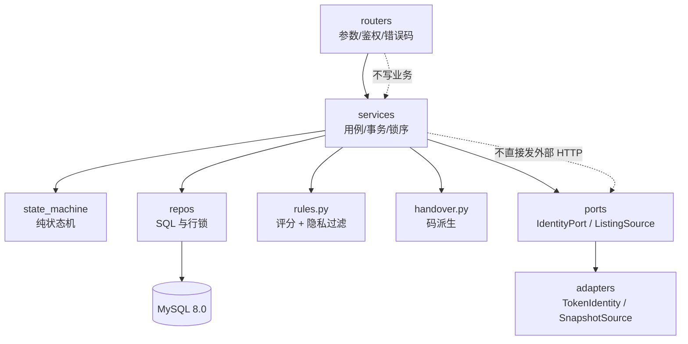

# 失物认领子系统 架构设计 v1.0

## 1. 结论与依据

采用**单进程分包单体**：一个 FastAPI 应用、一个 MySQL、按 router → service → repo 分层；仅对三个已知易变点加窄边界（外部端口 + DTO、纯函数规则、交接码策略）。

| 决策 | 认定 | 理由 |
| --- | --- | --- |
| 单进程分包单体为基底 | 【AI-Adopted】 | 本地单机演示，调用链短、排错成本低 |
| 窄外部端口 + DTO | 【Revised】 | 只隔离身份与招领两类只读依赖，不为每个类配接口 |
| 独立规则边界（`rules.py`） | 【Revised】 | 评分与过滤可单测、可整体替换，版本可冻结 |
| 消息中间件 / 服务拆分 / 逐类接口 | 【Rejected】 | 无对应替换需求，抬高维护成本 |
| 固定锁序 + 记录级唯一获批指针 | 【Revised】 | 由数据库约束兜底并发批准 |
| HMAC + nonce + 摘要的双向码 | 【Revised】 | 不存明文，可重派生，支持冷却与重置 |

## 2. 组件与依赖



| 模块 | 职责 | 依赖 | 隔离的易变点 |
| --- | --- | --- | --- |
| `app/routers/` | HTTP 编解码、幂等键、错误映射 | services、schemas | — |
| `app/services/` | 用例编排、事务边界、锁序 | repos、domain、rules、handover | — |
| `app/state_machine.py` | 认领状态与合法迁移 | 无 | FR-03/07 |
| `app/repos/` | 行锁、唯一获批指针、幂等表 | models | QR-06 |
| `app/ports.py` | 身份与招领的窄协议 | 无 | 易变点① |
| `app/rules.py` | 评分、过滤、规则版本 | 无（纯函数） | 易变点② |
| `app/handover.py` | nonce、HMAC 派生、摘要 | 无（纯函数） | 易变点③ |
| `app/adapters`（`routers/deps.py` + repo 快照） | 令牌适配器、快照读取 | ports | 契约替换点 |

## 3. 三个易变点如何被隔离

1. **身份/招领契约**：服务只依赖 `IdentityPort.resolve(token)` 与 `ListingSource.list_page/get`。真实对接时改 `TokenIdentity` 与快照同步适配器，service 不动；对外字段由 `serializers.public_listing` 单点裁剪。
2. **评分与隐私过滤**：`rules.py` 全是纯函数，配套 `RULE_VERSION="rules-v1.0"`。替换权重、阈值或过滤规则只改此文件与版本号，并触发 QR-04 重跑。
3. **交接码恢复/失效**：`handover.py` 用服务端密钥 + claim + role + nonce + 到期秒派生 8 位码；`handover_codes` 只存 nonce、密钥化摘要、到期、双方确认与冷却标记。**恢复方式是重新派生**，不是缓存明文。密钥轮换尚未实现（已知风险）。

## 4. 并发与事务

- 锁序固定：`listing_snapshots` 行 → `claims` 行 → `handover_codes` 行，避免交叉死锁。
- 唯一获批：`item_approvals.item_id` 为主键、`claim_id` 唯一；并发批准由数据库拒绝第二行，服务层转 409。
- 幂等：`idempotency_records` 以 `user:operation:key` 为主键，存请求哈希与**已脱敏**响应；内容不同即 409。
- 过期：`claims` 的 PENDING 7 天、APPROVED 交接 24 小时，通过条件 UPDATE 惰性收敛，批量列表时统一执行。

## 5. 安全与隐私

- 令牌：`v1.<payload>.<hmac>`，先验签再验 `exp`；不引入第三方 JWT 库，校验顺序显式可测。
- DTO 单点构造，`publisher_id`/`sender_id` 结构上无法泄露。
- 聊天过滤在服务端执行，命中即拒绝且不落库；日志与审计只记动作与 claim 关联，不记明文码。
- 前端只做纯文本渲染，接口不返回 HTML。

## 6. 目录

```
app/
  main.py config.py db.py models.py schemas.py serializers.py
  security.py errors.py clock.py idempotency.py
  ports.py rules.py handover.py state_machine.py
  routers/  claims.py chat.py listings.py matches.py demo.py meta.py deps.py
  services/ claim_service.py handover_service.py chat_service.py match_service.py access.py
  repos/    listing_repo.py claim_repo.py message_repo.py code_repo.py idempotency_repo.py audit_repo.py
docs/       api-contract.md srs-v1.0.md architecture-v1.0.md data-design.md process-design.md rtm-v1.0.csv
scripts/    init_db.py seed_demo.py local_mysql.ps1(环境协作者)
tests/unit/ 纯函数与契约用例
```

## 7. 未决与延后

- 交接码密钥轮换、跨进程共享（当前单进程内存限流）。
- 证据自动删除与争议恢复策略（已记录为后续改进，未实现）。
- 真实身份服务对接与字段契约仍以 `ports.py` 为唯一入口。
