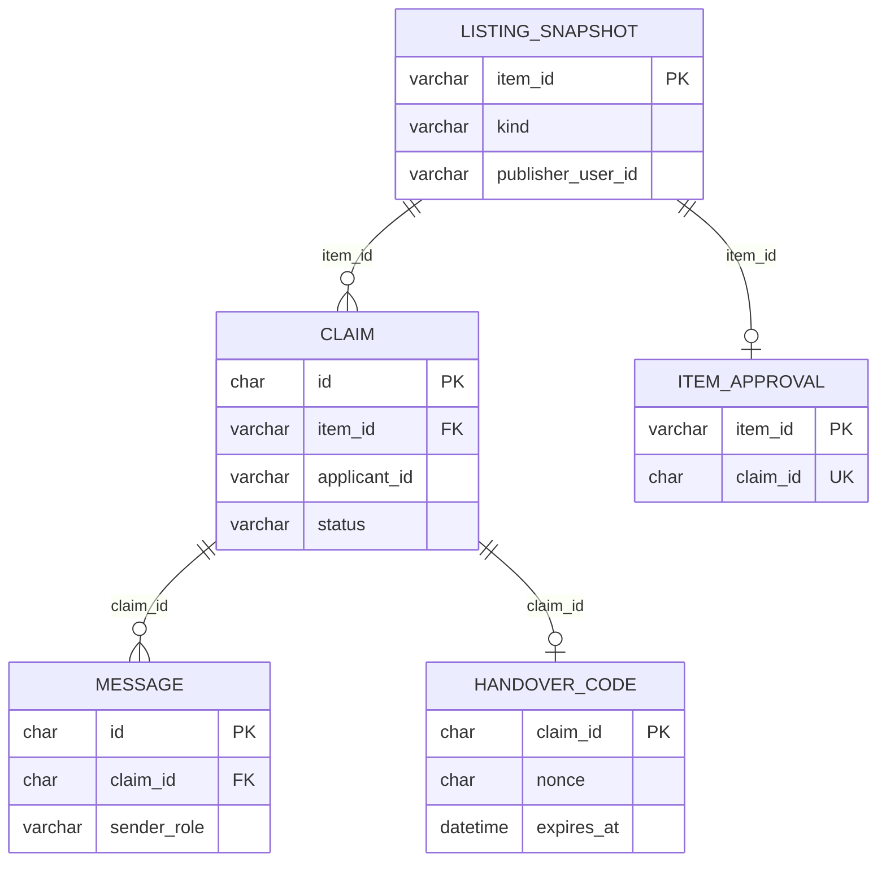

# 数据设计 v1.0

数据库：MySQL 8.0（`utf8mb4`），库 `claim_dev` / `claim_test`，实例 `127.0.0.1:33307`。
时间列统一存 **naive UTC**，序列化时补 `Z`。所有表由 `scripts/init_db.py` 创建，**只建不删**。

## 1. ER 图



## 2. 表与字段

### 2.1 `listing_snapshots`（外部只读快照）

| 列 | 类型 | 说明 |
| --- | --- | --- |
| `item_id` | VARCHAR(64) PK | 外部记录 ID |
| `kind` | VARCHAR(8) | `lost` / `found` |
| `title` | VARCHAR(200) | |
| `category` | VARCHAR(64) | 匹配用类别 |
| `occurred_at` | DATETIME | 丢失/拾获时间 |
| `location` | VARCHAR(200) | |
| `description` | TEXT | 公开描述 |
| `status` | VARCHAR(24) | 外部状态，默认 `published` |
| `publisher_user_id` | VARCHAR(64) | **内部字段，任何 DTO 不返回** |
| `origin` | VARCHAR(16) | `demo` / `upstream`，演示数据必须标 `demo` |
| `synced_at` | DATETIME | 本地同步时间 |

索引：`ix_listing_kind_status(kind,status)`、`ix_listing_publisher(publisher_user_id)`。

### 2.2 `claims`

| 列 | 类型 | 说明 |
| --- | --- | --- |
| `id` | CHAR(36) PK | UUID |
| `item_id` | VARCHAR(64) | 关联快照 |
| `applicant_id` | VARCHAR(64) | 申请人（内部） |
| `finder_id` | VARCHAR(64) | 批准时冻结的拾获方，避免快照改名导致越权 |
| `status` | VARCHAR(24) | 见状态机 |
| `evidence_text` | TEXT | 私有证据 |
| `item_number` | VARCHAR(64) NULL | 物品编号（私有） |
| `reason` | VARCHAR(500) NULL | 驳回/争议理由 |
| `created_at` / `updated_at` | DATETIME | |
| `decided_at` / `approved_at` | DATETIME NULL | |
| `handover_deadline` | DATETIME NULL | 批准后 24 小时 |
| `completed_at` | DATETIME NULL | |

索引：`ix_claims_item_status(item_id,status)`、`ix_claims_applicant(applicant_id,created_at)`、`ix_claims_finder(finder_id,created_at)`。

### 2.3 `item_approvals`（记录级唯一获批指针）

| 列 | 类型 | 说明 |
| --- | --- | --- |
| `item_id` | VARCHAR(64) PK | **同一条记录只能有一行 → 结构上阻止双批准** |
| `claim_id` | CHAR(36) UNIQUE | 一个申请不能批准两条记录 |
| `approved_at` | DATETIME | |

### 2.4 `handover_codes`

| 列 | 类型 | 说明 |
| --- | --- | --- |
| `claim_id` | CHAR(36) PK | 每申请一行 |
| `nonce` | CHAR(64) | 每次批准/重置重新生成 |
| `digest_applicant` / `digest_finder` | CHAR(64) | **密钥化摘要**，非裸 hash |
| `expires_at` | DATETIME | 30 分钟，且不超过交接绝对期限 |
| `attempts_applicant` / `attempts_finder` | INT | 每方独立计 5 次 |
| `cooldown_until_*` | DATETIME NULL | 60 秒冷却 |
| `cooldown_triggered_*` | BOOL | 判断"曾触发冷却才可重置" |
| `confirmed_applicant` / `confirmed_finder` | BOOL | 双确认 |
| `reset_count` | INT | 最多 2 次 |
| `issued_at` / `updated_at` | DATETIME | |

不留 `code` 列：码由 `HMAC(secret, claim|role|nonce|expiry)` 派生，可重算不可反推。

### 2.5 `messages`

`id` CHAR(36) PK、`claim_id` CHAR(36)、`sender_role` VARCHAR(16)、`body` TEXT、`created_at` DATETIME。
存角色而非用户 ID，别名由 `claim_id + role` 派生；索引 `ix_messages_claim_created(claim_id,created_at)`。

### 2.6 `idempotency_records`

`idem_key` VARCHAR(255) PK（`user:operation:client_key`）、`user_id`、`operation`、`request_hash`、`response_status`、`response_body` TEXT、`created_at`。
**只存脱敏响应**：不含身份映射与明文码。

### 2.7 `audit_events`

`id` BIGINT 自增、`actor_id`、`action`、`claim_id`、`item_id`、`detail`、`created_at`。
索引 `ix_audit_claim(claim_id,created_at)`。`detail` 不含码与身份。

## 3. 关键约束与取舍

1. **唯一获批**由 `item_approvals.item_id` 主键保证，不靠应用层判断。
2. **锁序**：`listing_snapshots` → `claims` → `handover_codes`；所有状态变更事务统一走此顺序。
3. **过期收敛**用条件 UPDATE（`WHERE status=? AND deadline < now`），避免读写放大。
4. **不存明文码**是有意为之：数据库泄露时攻击者仍需服务端密钥。
5. `publisher_user_id` 与 `applicant_id` 仅用于授权判断，永不进入响应 DTO。

## 4. 迁移与初始化

```powershell
python scripts/init_db.py --database dev     # 建表，不删数据
python scripts/init_db.py --database test
python scripts/init_db.py --database test --check   # 只报告缺表
```

V1.0 未引入 Alembic：表结构由 SQLAlchemy `metadata.create_all` 生成；后续变更需补迁移脚本。
