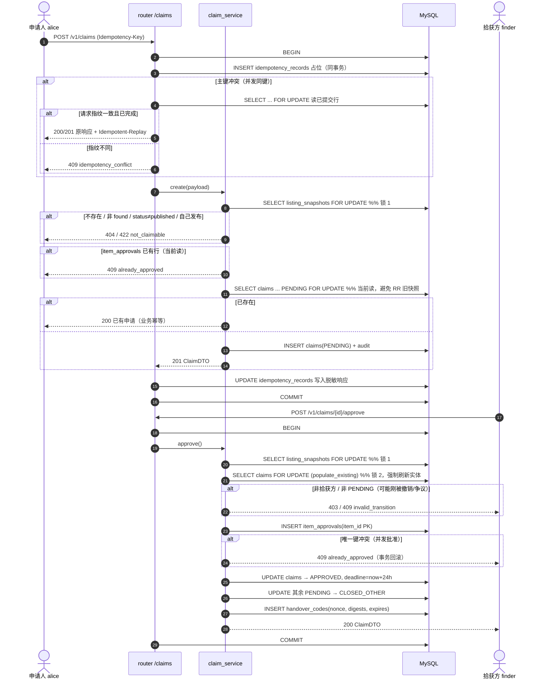
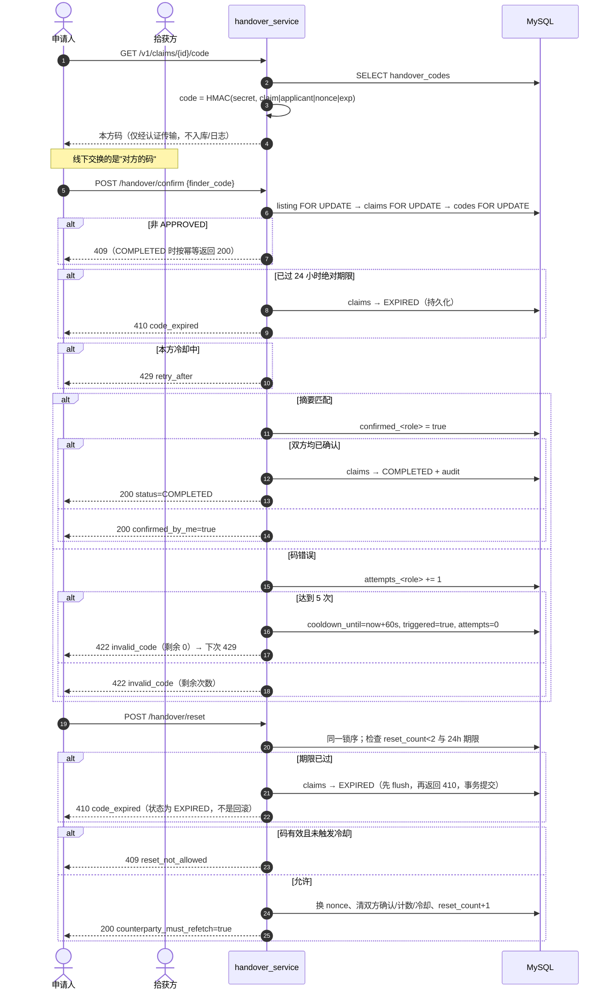

# 处理设计 v1.0.1

描述三个核心用例的时序与失败分支，字段以 `api-contract.md` 为准。
v1.0.1 变更：新增 UC-02 匿名沟通；交接确认改为 UC-03；消息发送与争议状态检查串行化。

## 1. UC-01 申请认领 → 核验 → 批准



要点：锁序固定 `listing → claim → code`；加锁读一律 `populate_existing`；批准是记录级唯一操作。

## 2. UC-02 匿名沟通（含争议冻结）

```mermaid
sequenceDiagram
  autonumber
  actor U as 参与方（申请人/拾获方）
  participant S as chat_service
  participant DB as MySQL

  U->>S: GET /claims/{id}/messages?after=&limit=
  S->>DB: 校验成员关系；按 (created_at,id) 键集读取
  S-->>U: items + next_after

  U->>S: POST /claims/{id}/messages {text}
  S->>DB: BEGIN
  S->>DB: SELECT claims FOR UPDATE (populate_existing)
  alt 非本申请成员
    S-->>U: 403
  end
  alt 状态 ∈ {PENDING, APPROVED}
    S->>S: scan_contact_info(text)
    alt 命中手机号/邮箱/证件号
      S-->>U: 422 contact_info_blocked（不落库）
    else 通过
      S->>DB: INSERT messages(sender_role, body)
      S-->>U: 201 MessageDTO
    end
  else DISPUTED / COMPLETED / 其他终态
    S-->>U: 409 invalid_transition（只读）
  end

  actor P as 任一参与方
  P->>S: POST /claims/{id}/dispute
  S->>DB: BEGIN; SELECT listing FOR UPDATE; SELECT claims FOR UPDATE
  S->>DB: UPDATE claims → DISPUTED
  S->>DB: COMMIT
  Note over U,S: 发送方持 claim 行锁，争议方需等锁，因此不会出现“先写消息再冻结”的 TOCTOU
```

争议后消息只读；发送与冻结在同一行锁上串行化。

## 3. UC-03 交接确认与冷却/重置



## 4. 失败与一致性

| 场景 | 处理 |
| --- | --- |
| 客户端重试（弱网） | 同键在事务内预占：同请求重放原响应，不同内容 409；不再出现 5xx |
| 同人不同键并发创建 | 记录行锁 + `FOR UPDATE` 当前读去重，只留一条 PENDING |
| 并发批准 | `item_approvals` 主键冲突 → 409，事务回滚 |
| 加锁后读到旧值 | 所有锁读 `populate_existing`，撤销/争议不会与批准/确认互相覆盖 |
| 争议后发消息 | claim 行锁串行化，DISPUTED 返回 409 |
| 猜码 | 每方独立 5 次 + 60 秒冷却；码长 8 位且绑定申请/角色/nonce/到期 |
| 旧码重放 | 重置即换 nonce，旧码摘要失效 |
| 交接超时 | 条件 UPDATE 收敛为 EXPIRED；reset/confirm 的 EXPIRED 先写库再返回 410 |
| 同秒消息 | 游标为 `(created_at, id)`，不丢消息；异会话游标 422 |
| 越权读会话/证据 | 每次请求按 `applicant_id` / `finder_id` 判定成员关系 |
