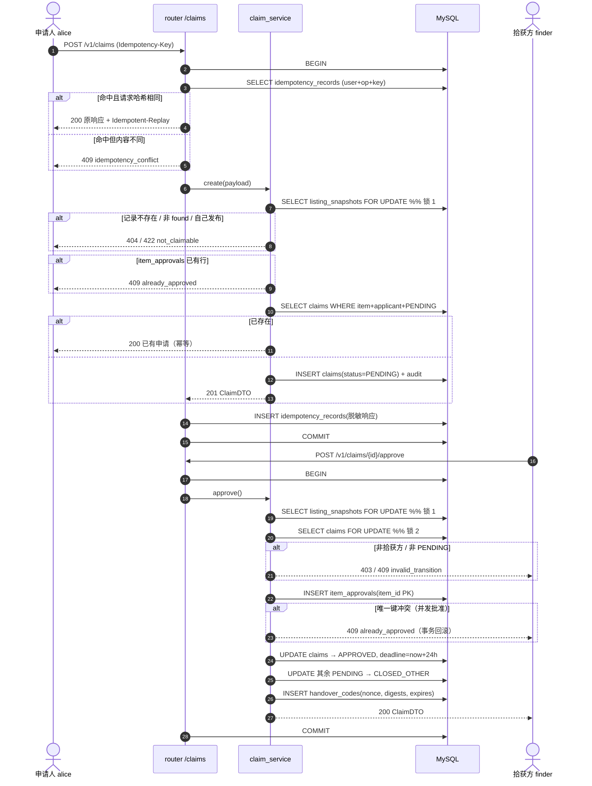
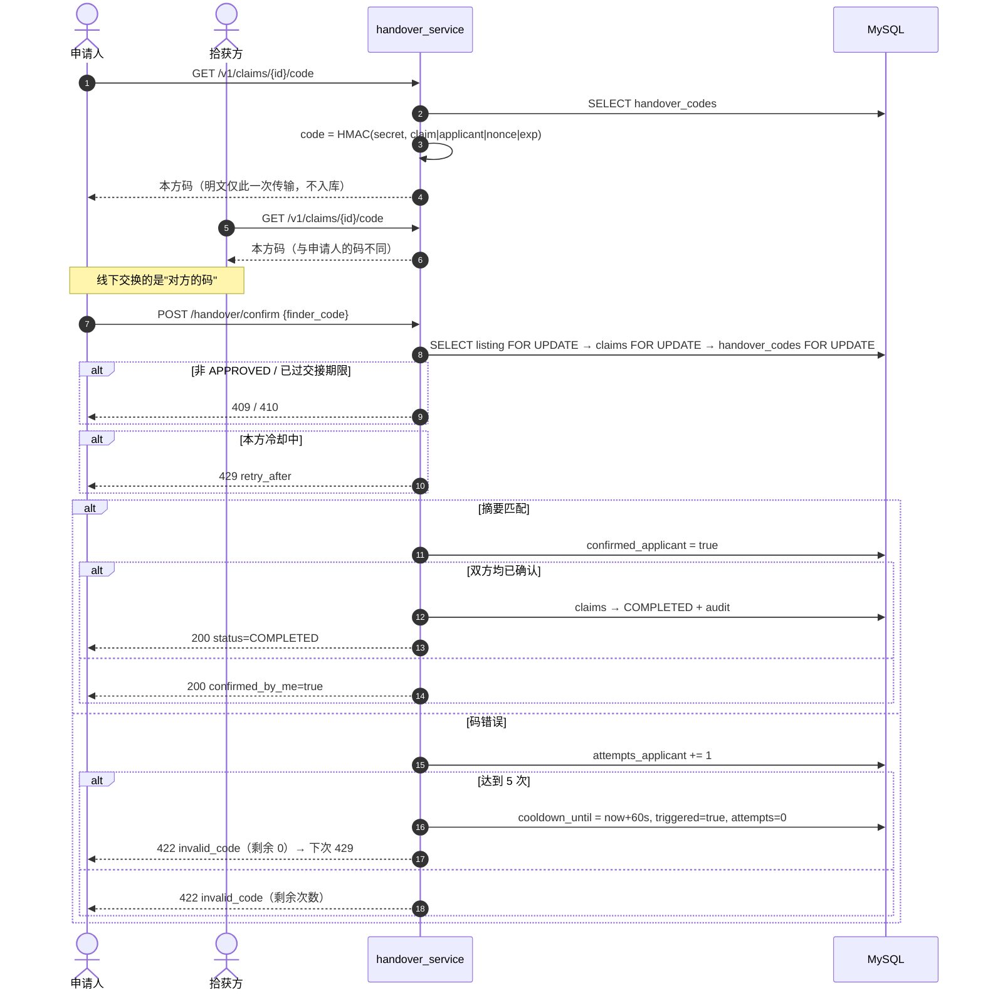

# 处理设计 v1.0

只描述两个核心用例的时序与失败分支，字段以 `api-contract.md` 为准。

## 1. UC-01 申请认领 → 核验 → 批准

要点：锁序固定；批准是记录级唯一操作；其余申请被系统关闭而不是驳回；幂等表存的是脱敏响应。

## 2. UC-02 交接确认与冷却/重置

重置分支：

1. 仅当**本方**曾触发冷却且冷却已结束，或码已到期；
2. 每申请最多 2 次，且未超过批准后 24 小时；
3. 重置换 nonce、清空双方确认与计数，旧码立即失效，响应提示 `counterparty_must_refetch=true`；
4. 仍有效且未触发冷却时重置 → 409 `reset_not_allowed`。

## 3. 失败与一致性

| 场景 | 处理 |
| --- | --- |
| 客户端重试（弱网） | 同 Idempotency-Key 重放；无 Key 时按业务幂等（重复申请返回已有 PENDING） |
| 并发批准 | `item_approvals` 主键冲突 → 409，事务回滚 |
| 猜码 | 每方独立 5 次 + 60 秒冷却；码长 8 位且绑定申请/角色/nonce/到期 |
| 旧码重放 | 重置即换 nonce，旧码摘要失效 |
| 交接超时 | 条件 UPDATE 收敛为 EXPIRED，再取码 410 |
| 越权读会话/证据 | 每次请求按 `applicant_id` / `finder_id` 判定成员关系 |
